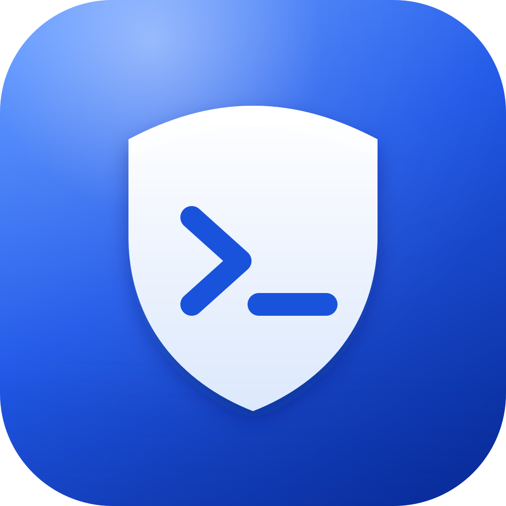
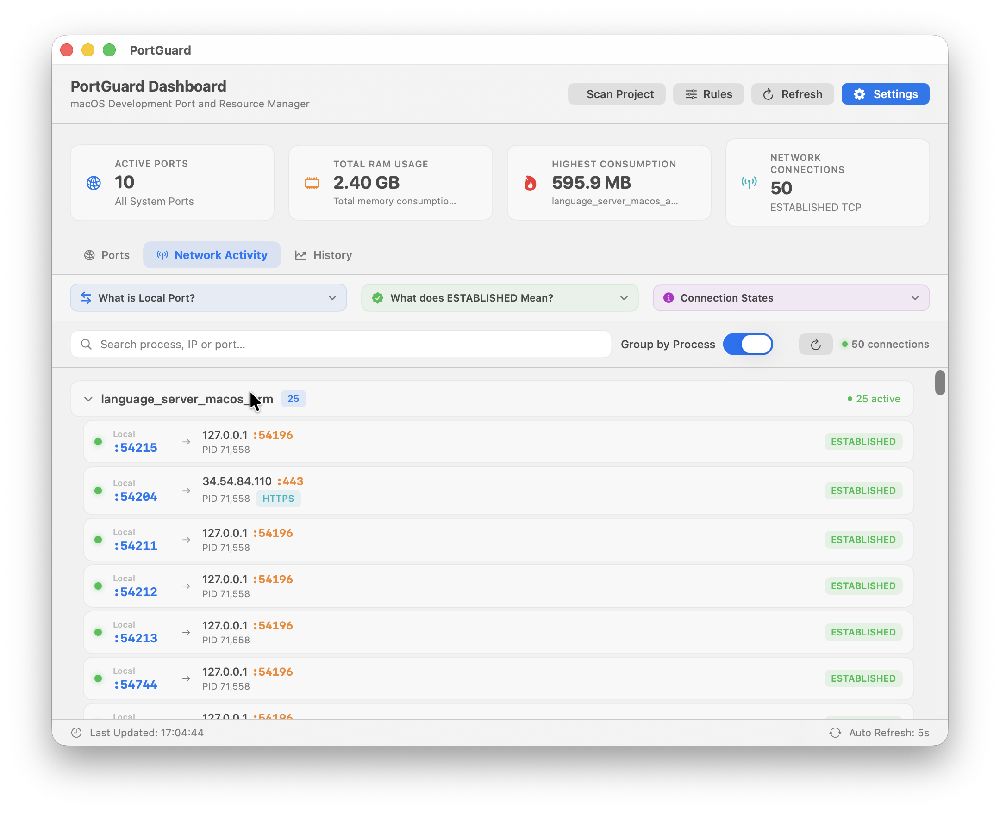
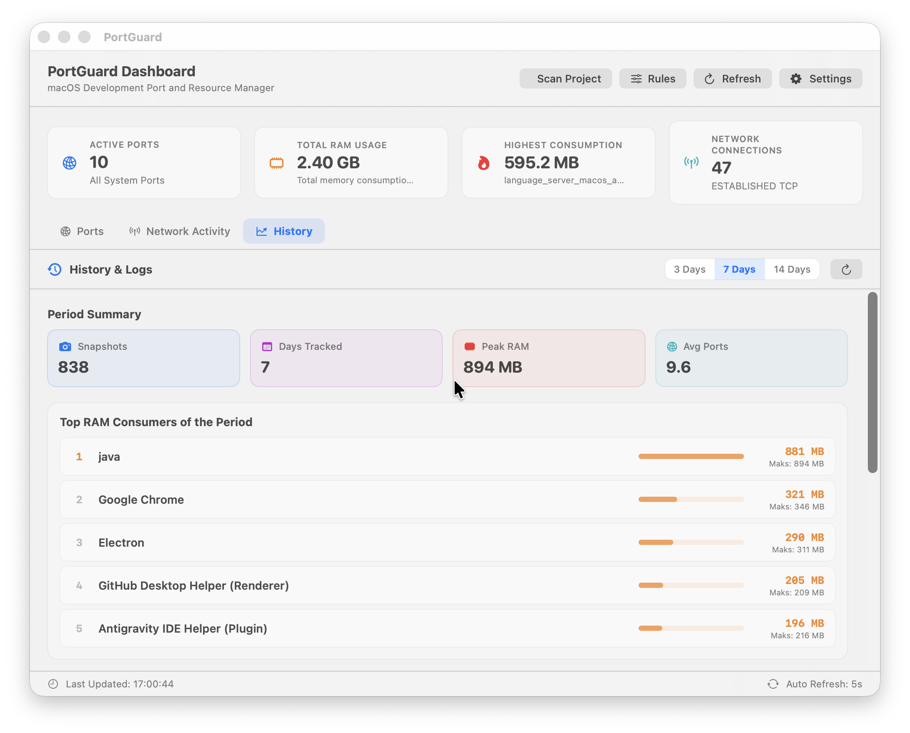

  

<h1 align="center">PortGuard</h1>

  Geliştirici portlarınızı izleyen, işlem bazında RAM ve CPU kullanımını gösteren 
  ve unutulan işlemleri tek tıkla durduran hafif bir macOS menü çubuğu uygulaması.

  <a href="README.md">English</a> | Türkçe

  <a href="https://github.com/okutaybozkurt/PortGuard/releases">İndir</a> &middot;
  <a href="https://github.com/okutaybozkurt/PortGuard">Kaynak kod</a> &middot;
  <a href="https://orhankutaybozkurt.com/projects/portguard#video">Tanıtım videosu</a>

---

## Sorun

Geliştirme sunucuları (Node, Python, Docker, Go, Flutter) terminal sekmesi kapatıldıktan sonra da çoğu zaman arka planda çalışmaya devam eder. Unutulan portlar gigabaytlarca RAM tüketir, bataryayı bitirir ve bir sonraki projede "address already in use" hatasına yol açar.

## Çözüm

PortGuard macOS menü çubuğunda ve tam bir kontrol paneli penceresinde çalışır. Hangi işlemin hangi portu kullandığını, ne kadar bellek ve CPU harcadığını gösterir ve doğru işlemi güvenle durmanızı sağlar.

## Özellikler

- **Anında tespit:** Dinlenen TCP portlarını ve PID değerlerini milisaniyeler içinde listeler.
- **Kaynak takibi:** İşlem bazında RAM ve CPU kullanımı, günlük geçmiş ve trendler.
- **Güvenli sonlandırma:** Komutu ve çalışma dizinini gösteren onay penceresiyle tek tıkla durdurma.
- **Port çakışması çözücü:** Meşgul bir portu tutan işlemi durdurup yeniden başlatma.
- **Kural motoru:** Eşik bazlı RAM ve CPU kuralları, bildirim veya otomatik sonlandırma.
- **Proje tarayıcı:** Proje dosyalarından gereken portları bulur ve çakışmaları bildirir.
- **Geliştirici filtresi:** Sistem servislerini gizler, geliştirme araçlarına odaklanır.
- **İki dilli:** Türkçe ve İngilizce, uygulama açıkken değiştirilebilir.
- **Yerel ve hafif:** SwiftUI ile yazıldı, arka planda minimum CPU kullanır.

## Ekran görüntüleri

| Geliştirici servisleri | Ağ aktivitesi |
| :---: | :---: |
|  |  |
| Yalnızca Node, Python, Docker gibi geliştirici araçları. | Aktif TCP bağlantıları ve canlı bant genişliği. |

| Geçmiş ve trendler | Kural motoru |
| :---: | :---: |
|  |  |
| Günlük RAM zirveleri, ortalama CPU ve port sayısı. | Eşik bazlı ihlal tespiti ve aksiyonlar. |

| Proje tarayıcı | Ayarlar |
| :---: | :---: |
|  |  |
| Proje dosyalarından port analizi ve çakışma uyarıları. | RAM limitleri, güncelleme kontrolü ve tema. |

## Gereksinimler

macOS 13.0 veya üzeri.

## Bağlantılar

- Sürümler ve kurulum: [github.com/okutaybozkurt/PortGuard](https://github.com/okutaybozkurt/PortGuard/releases)
- Tanıtım videosu: [orhankutaybozkurt.com](https://orhankutaybozkurt.com/projects/portguard#video)
- Lisans: MIT

## Geliştirici

[Orhan Kutay Bozkurt](https://github.com/okutaybozkurt) tarafından geliştirildi, Loka Labs tarafından paylaşılmaktadır.
